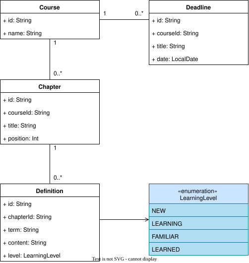

# Par cœur

Application Android pour apprendre des définitions par cœur. Les définitions sont rangées par cours, puis par chapitre, et chacune a un niveau d'apprentissage qui évolue au fil des révisions. On peut aussi associer des échéances à un cours (partiels, examens, oraux) pour savoir quoi réviser en priorité.

> Projet en cours de développement, version alpha.

## Fonctionnalités prévues

- Liste des cours, des chapitres d'un cours et des définitions d'un chapitre
- Niveau d'apprentissage pour chaque définition
- Échéances liées à un cours

## Stack

| | |
|---|---|
| Langage | Kotlin 2.4 |
| UI | Jetpack Compose, Material 3 |
| Navigation | Navigation Compose, routes type-safe |
| Architecture | Clean architecture, MVVM, découpage par feature |
| Build | Gradle (wrapper), AGP 9, versions centralisées dans `gradle/libs.versions.toml` |
| Qualité | ktlint, Android Lint sans avertissement, tests unitaires JUnit |
| CI/CD | GitHub Actions, Dependabot |

Android 8.0 (API 26) minimum.

## Lancer le projet

Prérequis : JDK 17, SDK Android (variable `ANDROID_HOME`), un téléphone en débogage USB ou un émulateur.

```powershell
git clone https://github.com/mpaitier/par_coeur.git
cd par_coeur
.\gradlew installDebug
```

Sous macOS ou Linux, remplacer `.\gradlew` par `./gradlew`.

Pour lancer les mêmes vérifications que la CI :

```powershell
.\gradlew ktlintCheck lintDebug testDebugUnitTest
```

## Modèle du domaine



Le fichier s'ouvre et se modifie avec [draw.io](https://www.drawio.com/).

## Feuille de route

| Version | Contenu |
|---|---|
| Alpha (`0.x.x-alpha.N`) | Données en mémoire, aucune connexion réseau |
| Beta (`0.x.x-beta.N`) | Données dans Firebase, règles de sécurité en mode test |
| 1.0.0 | Règles de sécurité de production |

## Documentation

- [Architecture](docs/architecture.md) : organisation du code et règles de dépendance
- [Contribuer](CONTRIBUTING.md) : branches, commits, vérifications et releases
